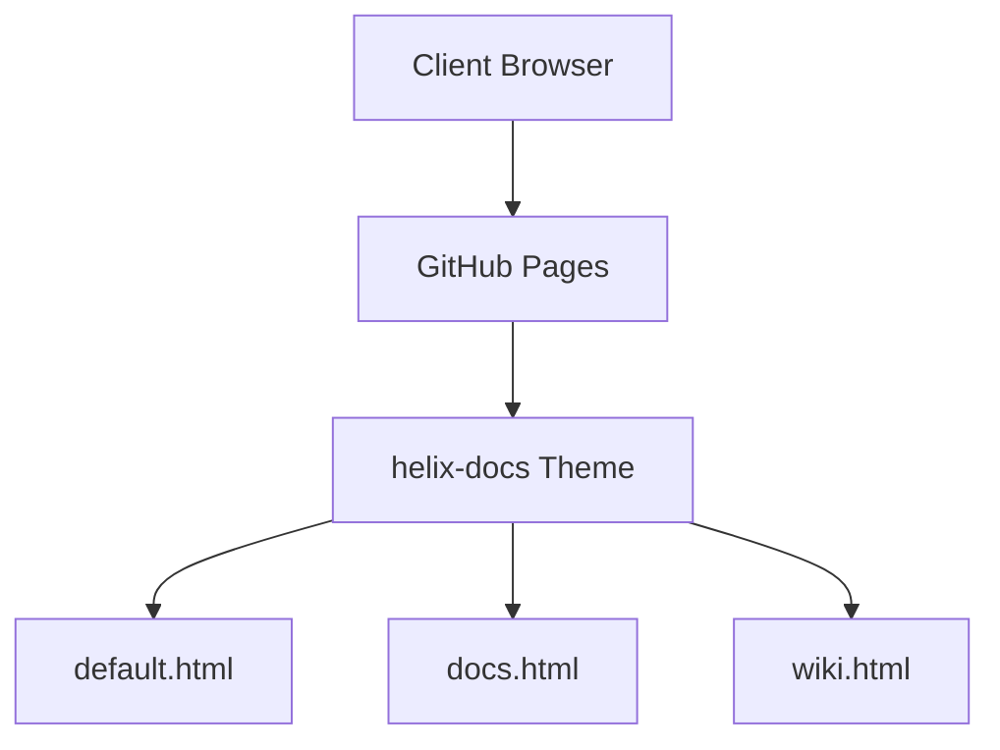

## 📊 Standard Markdown Tables

Tables are automatically styled with rounded borders, dark header panels, and responsive overflow wrappers:

| Feature | Support | Description |
| :--- | :--- | :--- |
| **GFM Syntax** | Native | Standard pipe-delimited Markdown tables |
| **Responsive Wrap** | Automatic | Auto-wrapped in `.table-wrap` for mobile devices |
| **Theme Highlights** | Built-in | Alternating row backgrounds and accent headers |

---

## 📝 Callout Notices

Use blockquotes or notice blocks to emphasize critical information:

> **Note:** Blockquotes in helix-docs are highlighted with accent borders and dark panel backgrounds.

```html
<div class="notice">
  <p><strong>Important:</strong> Custom callout box for alerts and warnings.</p>
</div>
```

---

## 🧜‍♀️ Mermaid Architecture Diagrams

Embed architecture diagrams using fenced code blocks with language `mermaid`:


